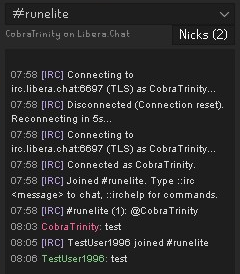
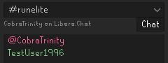
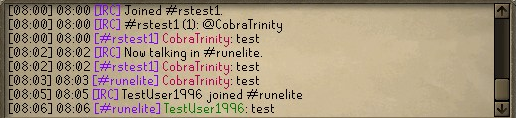

# IRC Chat for RuneLite

Chat on IRC without leaving the game. Messages appear in your chatbox and in a sidebar panel, and you reply with `::i` or by typing in the panel.

| Side panel | Nick list |
|---|---|
|  |  |

In the chatbox, each line is tagged with its channel:

## Setup

1. Enable **IRC Chat** in the RuneLite plugin list and open its settings.
2. Set **Channel** (e.g. `#mychannel`). The default server is `irc.libera.chat:6697` with TLS.
3. Optionally set a **Nickname** (otherwise your RuneScape name is used).
4. If your nick is registered, fill in **SASL account** and **SASL password**. **NickServ password** is only a fallback for servers without SASL.

The plugin connects as soon as a channel is set, and reconnects automatically if the connection drops (5s, doubling up to 5 minutes).

## Commands (type in the chatbox)

| Short | Long | What it does |
|---|---|---|
| `::i <message>` | `::irc <message>` | Say something in the channel |
| `::i` | `::irc` | Show connection status |
| `::ime <action>` | `::ircme <action>` | Send an action (`* YourNick waves`) |
| `::im <nick> <message>` | `::ircmsg <nick> <message>` | Private message someone |
| `::ir <message>` | `::ircreply <message>` | Reply to whoever last sent you a private message |
| `::inames` | `::ircnames` | List who's in the channel (with status and away markers) |
| `::iwhois <nick>` | `::ircwhois <nick>` | Show who someone is: account, away message, idle time, channels |
| `::itopic [new topic]` | `::irctopic [new topic]` | Show the channel topic, or set it (needs channel operator) |
| `::iignore [nick]` | `::ircignore [nick]` | Hide a nick's messages, notices and invites; no nick = list who you ignore |
| `::iunignore <nick>` | `::ircunignore <nick>` | Stop ignoring a nick |
| `::ijoin <#chan> [key]` | `::ircjoin` | Join another channel and talk there; with no channel, joins the last one you were invited to |
| `::ipart [#chan] [reason]` | `::ircpart` | Leave a channel (the one you're talking in if none is given) |
| `::iswitch [#chan]` | `::ircswitch` | Choose which channel `::i` and the channel commands use; with no channel, lists yours |
| `::iwatch [nick]` | `::ircwatch` | Get told when a nick comes online or goes offline; with no nick, lists your watch list |
| `::iunwatch <nick>` | `::ircunwatch` | Stop watching a nick |
| `::ikick <nick> [reason]` | `::irckick` | Kick someone (channel operators) |
| `::iban <nick or mask>` / `::iunban` | `::ircban` / `::ircunban` | Ban or unban; a bare nick becomes `nick!*@*` (channel operators) |
| `::imode <modes> [args]` | `::ircmode` | Set channel modes, e.g. `::imode +o SomeNick` (channel operators) |
| `::iaway [message]` | `::ircaway [message]` | Mark yourself away; no message = back |
| `::inick <nick>` | `::ircnick <nick>` | Change nick for this session |
| `::icaps` | `::irccaps` | Show which IRCv3 capabilities the server enabled |
| `::ic` / `::id` | `::ircconnect` / `::ircdisconnect` | Connect or disconnect manually |
| `::ih` | `::irchelp` | Show this list in-game |

`::` commands are handled by RuneLite and never sent to the game server.

## Side panel

The **#** button in the RuneLite sidebar opens an IRC panel with:

- Scrollback (last 500 lines) with timestamps, coloured nicks, highlighted mentions and clickable links.
- A channel picker at the top when you're in more than one channel. Each channel has its own scrollback; the picker shows unread counts, e.g. `#runelite (3)`. PMs, notices and status lines go to the channel you're viewing.
- A nick list (the **Nicks** button), sorted by rank. Double-click a nick to start a private message.
- An input box. Plain text goes to the channel; commands use `/` instead of `::` (`/msg`, `/me`, `/whois`, `/kick`, `/help`, ...). Start a message with `//` to send one that begins with `/`. Up/Down recalls what you typed.

Turn **Show in chatbox** off to keep IRC out of the game chatbox. If you hide the panel, messages always go to the chatbox.

## IRCv3 support

`IrcClient.java` is a dependency-free client with a barebones IRCv3 core:

| Spec | What it does here |
|---|---|
| Capability negotiation 3.2 (`CAP LS 302`) | Multi-line LS, REQ/ACK/NAK, capability values |
| `cap-notify` | Handles `CAP NEW` / `CAP DEL` after connecting |
| `sasl` (3.1/3.2) | PLAIN mechanism, chunked `AUTHENTICATE`, numerics 900–908 |
| `message-tags` | Full tag parsing/escaping; client tags can be attached to outgoing messages |
| `server-time`, `account-tag`, `msgid` | Exposed on every message event |
| `echo-message` | Your messages are shown as the server confirms them |
| `batch` | Tracks batches; netsplit/netjoin are collapsed into one line |
| `multi-prefix`, `userhost-in-names` | Accurate member list with all status prefixes and hosts |
| `extended-join`, `account-notify` | Tracks members' services accounts |
| `away-notify` | Tracks away status (optionally shown in chat) |
| `chghost`, `setname` | Keeps member host/real name current |
| `invite-notify` | Shows channel invites |
| `MONITOR` | The watch list: online/offline notices for chosen nicks |
| `sts` | On plaintext, reconnects over TLS on the advertised port |
| Standard replies | `FAIL` / `WARN` are shown in chat |

It also reads `RPL_ISUPPORT` (`PREFIX`, `CHANMODES`, `CHANTYPES`, `CASEMAPPING`, `NICKLEN`, `NETWORK`) and compares nicks using the server's casemapping.

Not implemented: `labeled-response`, `chathistory`, `draft/multiline`, SASL mechanisms other than PLAIN (e.g. EXTERNAL/SCRAM), and persisting STS policies across restarts (they're kept for the RuneLite session).

## Notes

- Messages show in the **Game** chat tab. If you use a transparent chatbox, change **Message colour** to something light (the default black is meant for the opaque chatbox).
- While you're logged out, IRC messages are held and shown once you log in (the most recent 50; older ones are counted and dropped). Posting game messages with no character loaded breaks other plugins that react to chat, such as Loot Tracker.
- **Other channels** are joined along with **Channel**. Editing the list joins or leaves just the difference, without reconnecting. Channels joined with `::ijoin` are rejoined if the connection drops, but not after a restart; add them to **Other channels** to keep them.
- The **Watch list** uses IRCv3 `MONITOR` (Libera allows 100 nicks). You're told when someone comes online or goes offline, with an optional notification.
- **Highlight words** notify you like your nick does, and are highlighted in the side panel. **Show timestamps** adds `HH:mm` to chatbox lines.
- **Away when logged out** (off by default) marks you away on IRC while you're at the login screen and back when you log in. It never replaces an away message you set with `::iaway`.
- If you message someone who is away, their away message is shown.
- **Colour each nick** (on by default) gives every nick its own colour, picked from the name so it stays the same between sessions. Turn it off to use the single **Nick colour**.
- The ignore list is saved in the **Ignored nicks** setting, so it survives restarts and can be edited there too. It hides people on your side only; they aren't told.
- IRC colour/bold codes are stripped, and `<` `>` are escaped so nobody can inject RuneLite chat tags.
- Outgoing messages are rate-limited after registration to avoid flood kicks, and long messages are split automatically.
- Passwords are stored in your RuneLite config like any other setting. Keep TLS on: SASL PLAIN sends the password base64-encoded, not encrypted.

## Development

Run `IrcPluginTest` (in `src/test`) from IntelliJ to start RuneLite with the plugin loaded, or `./gradlew build` to compile. `IrcClientTest` covers the parser, tag escaping, casemapping, CAP lists, formatting stripper, message splitting, and WHOIS/topic replies. `IrcPluginHelpersTest` covers nick colours and duration formatting.
